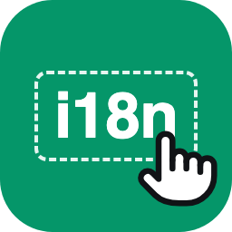

# Ignat Sm

Product designer and builder.

[X](https://x.com/ignat_en) · [Email](mailto:ignsm94@gmail.com)

<table>
  <tr>
    <td width="88" valign="top"></td>
    <td>
      <a href="https://formhaus.dev"><b>Formhaus</b></a> 
      Write your forms once and render them everywhere. One JSON form definition holds the fields, validation, conditions, steps and branching.
      <ul>
        <li>MIT engines for <a href="https://github.com/formhaus-dev/formhaus">TypeScript</a>, <a href="https://github.com/formhaus-dev/formhaus-swift">Swift</a> and <a href="https://github.com/formhaus-dev/formhaus-kotlin">Kotlin</a>, checked against one conformance suite</li>
        <li>Renderers for React, Vue and Jetpack Compose, plus a Figma plugin</li>
        <li>An MCP server, so coding agents can write and repair forms: <code>npx formhaus</code></li>
        <li><a href="https://formhaus.dev/cloud">Formhaus Cloud</a> hosts forms and collects submissions, if you don't want to run a backend</li>
      </ul>
      <a href="https://formhaus.dev/guide/">Docs</a> · <a href="https://formhaus.dev/play">Playground</a> · <a href="https://formhaus.dev/cloud">Cloud</a>
    </td>
  </tr>
  <tr>
    <td width="88" valign="top"></td>
    <td>
      <a href="https://monmot.com"><b>Monmot</b></a> 
      A reading app and browser extensions for learning languages. Save unfamiliar words as you read, then learn them as flashcards or in interactive practice.
      <ul>
        <li>Android, iPhone and Mac apps, browser extensions, a web app, the API and an MCP server</li>
        <li>I design, build and run all of it. The source is private for now</li>
      </ul>
      <a href="https://monmot.com">Website</a> · <a href="https://chromewebstore.google.com/detail/monmot/aldcopkclldafobcmdddijejmjaoeolh">Chrome extension</a> · <a href="https://apps.apple.com/us/app/monmot/id6796633976">iOS app</a> · Android coming soon
    </td>
  </tr>
  <tr>
    <td width="88" valign="top"></td>
    <td>
      <a href="https://github.com/ignsm/i18n-key-inspector"><b>i18n-key-inspector</b></a> 
      Point at any text on the page and see the translation key that made it, even after <code>v-html</code> or late hydration. Works with vue-i18n, and with Nuxt through <a href="https://github.com/ignsm/nuxt-i18n-inspector">nuxt-i18n-inspector</a>.
    </td>
  </tr>
</table>
